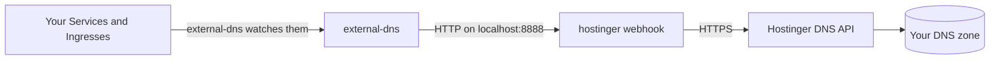

# external-dns-hostinger-webhook

[](https://github.com/hayone1/external-dns-hostinger-webhook/actions/workflows/ci.yml)
[](https://github.com/hayone1/external-dns-hostinger-webhook/actions/workflows/e2e.yml)
[](https://github.com/hayone1/external-dns-hostinger-webhook/releases)
[](https://hub.docker.com/r/hayone/external-dns-hostinger-webhook)
[](https://scorecard.dev/viewer/?uri=github.com/hayone1/external-dns-hostinger-webhook)
[](LICENSE)

Make Kubernetes keep your **Hostinger DNS** records up to date, all by itself.

You add a hostname to a Service or Ingress in Kubernetes. A few seconds later,
the DNS record shows up in your Hostinger DNS zone. Change the Service and the
record changes. Delete it and the record goes away.

## What is this?

[ExternalDNS](https://github.com/kubernetes-sigs/external-dns) is a popular
Kubernetes tool. It watches your cluster and writes DNS records for you.
It knows how to talk to many DNS companies, but not to Hostinger.

This project fills that gap. It is a small **webhook**: a helper program that
runs next to external-dns (in the same pod) and translates its requests into
calls to the [Hostinger API](https://developers.hostinger.com/).



## Features

- Creates, updates and deletes **A, AAAA, CNAME and TXT** records. **MX and
  SRV** work too, if you use them through external-dns.
- Works with every active domain in your Hostinger account, or only the
  ones you pick. Domains registered elsewhere but hosted on Hostinger DNS
  work too.
- Works with every external-dns source: Services, Ingresses, Gateway API
  routes and more.
- Never deletes or replaces records it did not create. Records you made by
  hand in hPanel stay as they are, even when they share a name with one of
  yours.
- Safe to restart and safe to retry: creating something that exists, or
  deleting something that is gone, is not an error.
- One bad record does not block the others.
- Stays inside Hostinger's limit of 90 API requests per minute, and waits
  when Hostinger asks it to.
- Never resets a zone, never restores a snapshot, and never touches
  Hostinger's own NS and SOA records.
- Small and locked down: a small image with no shell, running as a non-root
  user. Images for `amd64` and `arm64`, signed with cosign, with an SBOM and
  SLSA Build Level 3 provenance. Each release ships a values file with the
  image pinned by digest.
- Prometheus metrics and health checks built in.
- Tested on every change in a real cluster with real external-dns, against a
  fake Hostinger API that copies the real one's quirks. Maintainers also test
  against the real Hostinger API before releases.

## Quick start

You need: a Kubernetes cluster, [Helm](https://helm.sh/), a Hostinger
account, and a domain in it.

**1. Make sure your domain uses Hostinger's name servers.** Records in
Hostinger only work if the internet asks Hostinger's servers about your
domain. Domains bought at Hostinger use them already. Check with:

```sh
dig +short NS example.com
```

You should see:

```text
ns1.dns-parking.com.
ns2.dns-parking.com.
```

If not, set those two name servers in hPanel (Domains > your domain > DNS /
Nameservers), or at your domain registrar if the domain is registered
somewhere else.

**2. Create an API token.** In hPanel, open your profile, then **API**, and
create a token. **Give it an expiry date.** Copy it right away: Hostinger
shows it only once.

> **Warning:** a Hostinger API token has no limits. It can do everything
> your account can do: servers, billing, domains, not only DNS. Treat it like
> your password. Keep it in a Kubernetes Secret, never in a values file or Git.

**3. Save the token in Kubernetes.**

```sh
kubectl create namespace external-dns
kubectl -n external-dns create secret generic hostinger-credentials \
  --from-literal=api-token='paste-your-token-here'
```

**4. Install external-dns with the webhook.** Download
[deploy/helm/values.yaml](deploy/helm/values.yaml), replace `example.com`
with your domain and `my-cluster` with a name for your cluster, then:

```sh
helm repo add external-dns https://kubernetes-sigs.github.io/external-dns/
helm upgrade --install external-dns external-dns/external-dns \
  --namespace external-dns -f values.yaml
```

**5. Try it.** Add a hostname to any Service:

```sh
kubectl annotate service my-app \
  external-dns.kubernetes.io/hostname=app.example.com
```

Wait a minute, then check: `dig +short app.example.com @ns1.dns-parking.com`

The full guide, with every option explained, is in [docs/deployment.md](docs/deployment.md).

## Settings you should not skip

These are already in the example values file. Here is why they matter:

| Setting | Why |
|---|---|
| `txtPrefix: "extdns-%{record_type}."` | external-dns writes a small TXT record next to each record to remember that it owns it. Without this prefix, the TXT record for your bare domain (`example.com`) would be named `a-example.com`, which is outside your zone. external-dns could then never clean up that record. |
| `--txt-wildcard-replacement=wildcard` | Hostinger does not allow `*` in the middle of a name, so the TXT record for `*.example.com` needs a different name. |
| `--webhook-provider-read-timeout=30s` and `--webhook-provider-write-timeout=60s` | The webhook sends about one API request per second to stay inside Hostinger's limit. A big batch of changes takes longer than external-dns waits by default. |
| `interval: 1m` | Every loop costs API requests. All your Hostinger tools share one budget of 90 requests per minute. |

## Good to know

- **A new zone has two records already.** Hostinger points the bare domain
  (`example.com`) to a parking page and adds a `www` CNAME. external-dns did
  not create them, so it will not change them. To let external-dns manage
  `example.com` or `www.example.com`, delete those records in hPanel first.
- **Changes take up to the TTL to show.** A brand new name answers within
  seconds. A changed or deleted record can show the old answer for as long as
  its TTL (time to live), because Hostinger's name servers cache answers.
- **TTL is 60 seconds to 1 day.** Hostinger refuses anything outside that
  range, so the webhook uses the nearest allowed value and logs a warning.
- **Undo button.** Hostinger saves a snapshot of the zone at every change.
  If something goes wrong, you can restore an older snapshot in hPanel or
  with the Hostinger API. The webhook never does this for you.
- **Use the new annotation prefix.** external-dns v0.23 and newer read
  `external-dns.kubernetes.io/hostname`. The old `external-dns.alpha.kubernetes.io/`
  prefix only works if you start external-dns with `--enable-legacy-annotation-prefix`.
- **No NS, PTR or ALIAS records**, and no weighted or geo routing (endpoints
  with a `set-identifier` are skipped). Hostinger's API refuses NS records
  below the bare domain, so sub-domains cannot be delegated through it.
- **CAA records:** the webhook can read and write them, but external-dns
  (v0.24) cannot track who owns a CAA record, so it never cleans them up.
  Manage CAA records by hand.

## Documentation

| Read this | When you want to |
|---|---|
| [Deployment guide](docs/deployment.md) | install, upgrade or remove the webhook |
| [Configuration](docs/configuration.md) | see every setting |
| [How it works](docs/how-it-works.md) | understand what happens to your records |
| [Troubleshooting](docs/troubleshooting.md) | fix something that does not work |
| [Metrics and health checks](docs/metrics.md) | monitor the webhook |
| [Hostinger API notes](docs/hostinger-api.md) | know the Hostinger API's surprises |
| [Development](docs/development.md) | build, test or change the code |
| [Releasing](docs/releasing.md) | publish a new version (maintainers) |

## Images

The same signed image is on two registries. Pick one:

```text
ghcr.io/hayone1/external-dns-hostinger-webhook:<version>
docker.io/hayone/external-dns-hostinger-webhook:<version>
```

See the [releases page](https://github.com/hayone1/external-dns-hostinger-webhook/releases)
for versions. Tags come with and without the `v` (`0.1.0` and `v0.1.0`
are the same image). Always pin a version; do not use `latest` in production.

## Contributing

Help is welcome. Start with [CONTRIBUTING.md](CONTRIBUTING.md). AI coding
agents should read [AGENTS.md](AGENTS.md).

Found a security problem? Please report it privately, as described in
[SECURITY.md](SECURITY.md).

## License

[Apache License 2.0](LICENSE). You may use, copy, change and share this
project for free, also in commercial products. Keep the copyright notice and
the [NOTICE](NOTICE) file when you do.

This project is not made by or connected to Hostinger or the Kubernetes project.
